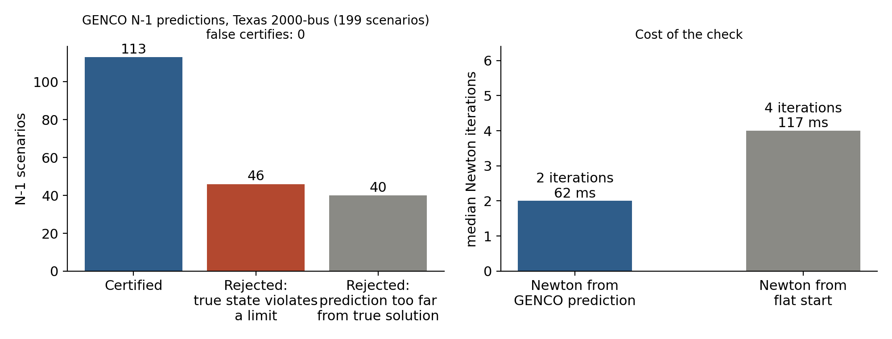

# A certify-or-reject layer for GENCO under N-1 contingencies

**In one line:** an AC Newton-Raphson solve warm-started from GENCO's prediction certifies the prediction only when it sits next to a true AC solution that satisfies every voltage, thermal and generator reactive limit. Otherwise it rejects the prediction and sends the case to a full study.

## Data
Everything is from the public GENCO release, so the result is reproducible without retraining anything:
- **GENCO predictions:** `huggingface.co/gridfm/genco-pf-contingency`, file `mlflow/eval/test_1/predictions.parquet`. These are the paper checkpoint's N-1 predictions on Texas2k_case1_2016summerpeak.
- **Network and ground truth:** the published raw tables for the same split (bus, branch, generator and Y-bus parquet), used to rebuild each scenario's network.
- **Scenarios evaluated:** scenario partition 0 of `test_1`, which is 199 N-1 scenarios on the 2000-bus grid.
- **Consistency check:** before trusting the setup, the published ground-truth solution was checked against the rebuilt power-flow equations for every scenario. The worst mismatch is about 1e-9 pu.

## Method (`certify.py`, model-agnostic)
1. Fix PV and reference voltage magnitudes and the reference angle to their specified values, then run polar Newton-Raphson from the model's (Vm, θ). Convergence means a 1e-8 pu mismatch within 15 iterations.
2. **Distance test:** the converged point must be within 0.01 pu and 1° of the prediction at every bus. Otherwise the prediction did not identify the solution, and the case is rejected.
3. **Limit test** at the converged point: bus voltage bounds, branch apparent-power ratings at both ends, and bus-aggregated generator reactive limits. Any violation means a rejection.
4. **CERTIFIED** only if both tests pass. Rejected cases fall back to the classical study.
5. **Every certified verdict is audited** against the published ground truth. A false certify is a certified case whose true solution differs from the converged point or violates a limit.

## Results, 199 N-1 scenarios

| | Count |
|---|---|
| Certified | 113 (57%) |
| Rejected: the true N-1 state itself violates a limit | 46 |
| Rejected: the prediction is more than 0.01 pu / 1° from the true solution | 40 |
| **False certifies** | **0** |

- Of the 199 true N-1 states, 59 violate at least one limit, and the layer rejected all 59.
  - On a 60-scenario breakdown, 5 of those states fail thermal ratings and 16 fail generator reactive limits. The reactive failures are expected, because the PF-mode data does not enforce Q limits.
- GENCO's raw predictions are accurate:
  - mean voltage-magnitude error 1.3e-4 pu (worst bus 0.022 pu)
  - mean angle error 0.26°
  - median power-balance mismatch 0.014 pu
- **Raw predictions can't be limit-checked directly.** Evaluated as-is, 189 of 199 fail a limit check, mostly generator reactive limits: 52 of 60 on the breakdown, against 16 of 60 for the true states. Reactive power recovered from an approximate state is very sensitive to small voltage errors, which is the reason for solving first and checking limits after.
- **Cost:** warm-starting from GENCO halves Newton iterations (median 2 vs 4 from a flat start) and wall time (62 ms vs 117 ms per scenario, single CPU thread, scipy sparse solver). No flat-start solve failed on this partition.



Slides: [`slides/GENCO-certify-or-reject.pdf`](slides/GENCO-certify-or-reject.pdf)

## Limits of this first version
- **Coverage so far:** one partition of the N-1 split (199 of 8,823 scenarios). The other partitions and the N-2 to N-20 splits use the same pipeline (`fetch.py <partition> <split>`).
- **Tolerances are design choices.** The 0.01 pu / 1° distance rule decides most of the "too far" rejections. A looser rule certifies more cases; the audit against ground truth is what keeps it honest either way.
- **No new physics.** Limits are those in the published tables. Generator reactive limits are checked per bus in aggregate, and angle-difference limits are not checked yet.
- **Not plugged into gridfm-graphkit yet.** The natural next step is a thin adapter that runs `certify()` on `gridfm_graphkit predict` outputs.

## How it would fit OpenGridFM
A post-processing step after `predict`, which:
- certifies each prediction or flags it for a classical solve, with the reason
- reports a feasibility margin per scenario
- gives users a guarantee that any answer marked certified is an AC-feasible, limit-satisfying operating point

## Reproduce
```
pip install -r requirements.txt
python fetch.py 0 test_1      # downloads partition 0 (~170 MB of tables + GENCO predictions for those scenarios)
python evaluate.py 0 test_1   # ~2 min on a laptop; writes results/summary_test_1_part0.json and per-scenario CSV
python figure.py
```
