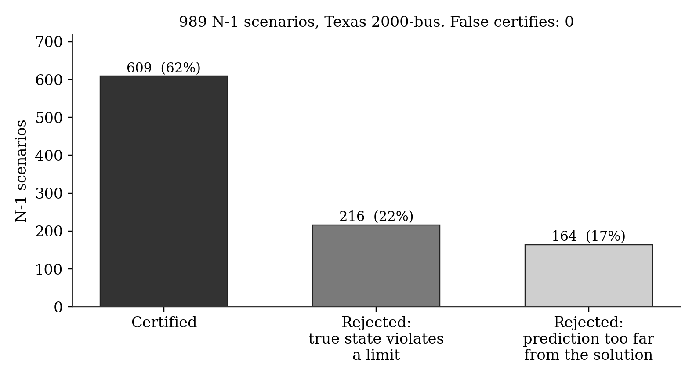
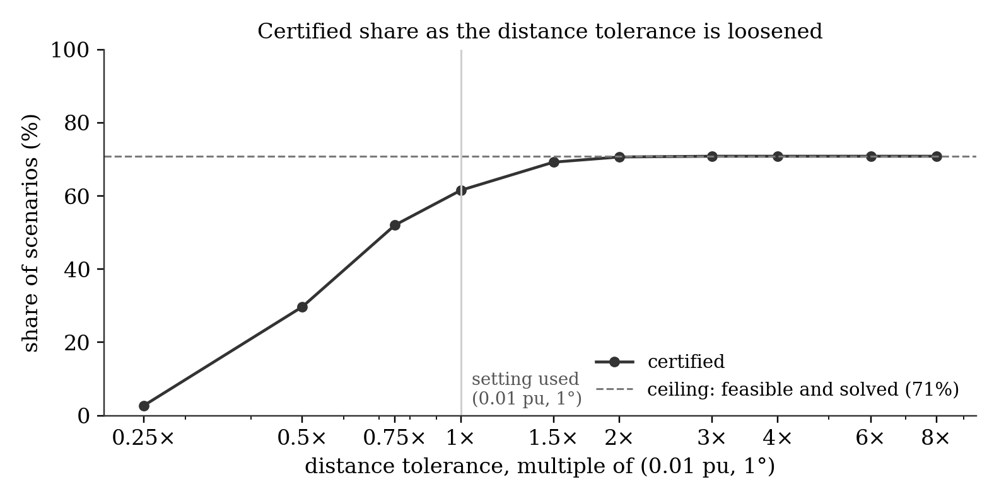
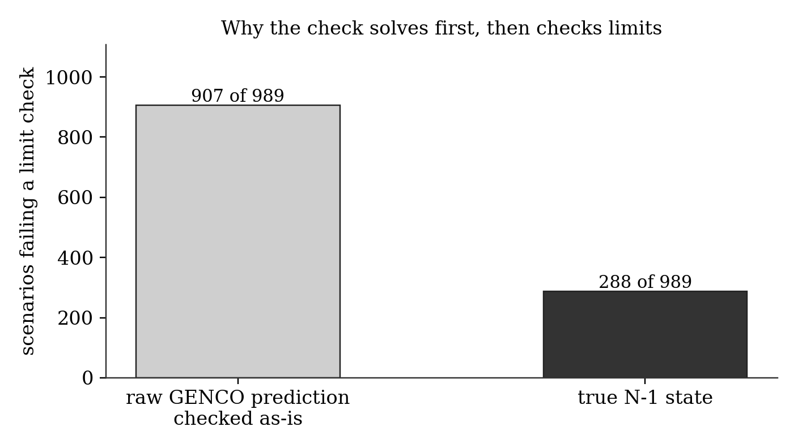
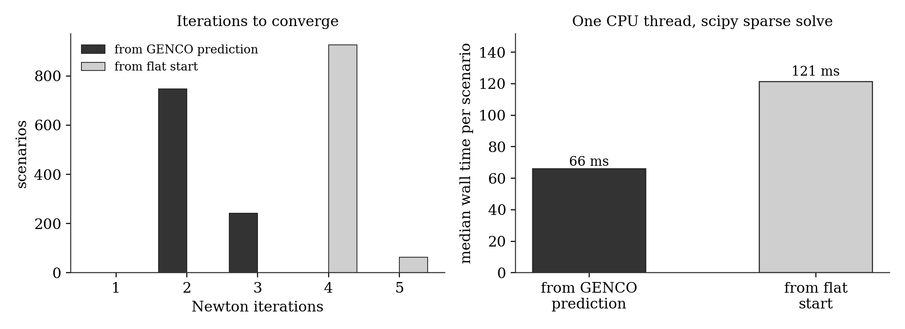

# A certify-or-reject check for GENCO under N-1 contingencies

An AC Newton-Raphson solve, warm-started from GENCO's prediction, certifies the prediction only when it sits next to a true AC solution that satisfies every voltage, thermal and generator reactive limit. Otherwise the check rejects it, says why, and the case goes to a full study. This is a first version and still in progress.

## Data
Everything comes from the public GENCO release, so nothing is retrained.
- **GENCO predictions:** `huggingface.co/gridfm/genco-pf-contingency`, file `mlflow/eval/test_1/predictions.parquet`, the paper checkpoint's N-1 predictions on Texas2k_case1_2016summerpeak.
- **Networks and ground truth:** the published bus, branch, generator and Y-bus tables for the same split, used to rebuild each scenario's network.
- **Scenarios evaluated so far:** partitions 0 to 4 of `test_1`, which is 989 N-1 cases on the 2000-bus grid out of 8,823 in the split.
- **Check before trusting the setup:** the published ground-truth solution satisfies the rebuilt power-flow equations on every scenario, with a worst mismatch around 1e-9 pu.

## Method (`certify.py`, model-agnostic)
1. Fix PV and reference voltage magnitudes and the reference angle, then run polar Newton-Raphson from the model's (Vm, θ). Converged means a mismatch below 1e-8 pu within 15 iterations.
2. **Distance:** the converged point has to be within 0.01 pu and 1° of the prediction at every bus. Otherwise the prediction didn't identify the solution and the case is rejected.
3. **Limits** at the converged point: bus voltage bounds, branch apparent-power ratings at both ends, and generator reactive limits aggregated per bus.
4. **CERTIFIED** only if 1 to 3 pass. Rejected cases go to the classical study.
5. **Every certified verdict is audited** against the published ground truth. A false certify is a certified case whose true solution differs from the converged point or violates a limit.

## Results, 989 N-1 scenarios

| | Scenarios |
|---|---|
| Certified | 609 (62%) |
| Rejected: the true N-1 state itself violates a limit | 216 |
| Rejected: the prediction is more than 0.01 pu / 1° from the true solution | 164 |
| **False certifies** | **0** |



- 288 of the 989 true N-1 states violate at least one limit, and the check rejected all 288.
- GENCO's raw predictions are accurate on average: mean voltage-magnitude error 1.2e-4 pu, mean angle error 0.25°, median power-balance mismatch 0.013 pu.

### The distance tolerance
Most "too far" rejections come from the 0.01 pu, 1° rule, which is a design choice. Doubling it raises the certified share from 62% to 71%, and it levels off at 71%, the share of scenarios that are feasible. On this data, whenever Newton converged it converged to the true solution, so loosening the rule didn't add wrong answers. I wouldn't assume that carries to the harder N-k splits.



### Why solve first, then check
Checked as-is, 907 of 989 raw predictions fail a limit check, against 288 of 989 true states. Most of the gap is generator reactive limits, because reactive power recovered from an approximate state is very sensitive to small voltage errors. Solving from the prediction removes that noise.



### Cost
Warm-starting from GENCO takes a median of 2 Newton iterations against 4 from a flat start, 66 ms against 121 ms per scenario on one CPU thread with scipy's sparse solver. No flat-start solve failed on these partitions.



Slides: [`slides/GENCO-certify-or-reject.pdf`](slides/GENCO-certify-or-reject.pdf)

## What this doesn't show yet
- **Coverage:** 989 of 8,823 N-1 scenarios, and none of the N-2 to N-20 splits yet. They use the same pipeline (`fetch.py <partition> <split>`).
- **Limits:** only those in the published tables. Generator reactive limits are aggregated per bus, and angle-difference limits aren't checked yet.
- **Tolerances** are my choice, and the audit against ground truth is what keeps any setting honest.
- **Not integrated** into gridfm-graphkit yet. It runs on GENCO's saved predictions.

## Working on next
- The rest of the N-1 split, then the N-2 and higher splits.
- A thin adapter so `gridfm_graphkit predict` outputs go straight into `certify()` and come back with a verdict, a reason and a margin per scenario.
- Per-generator reactive limits and angle-difference limits.
- A feasibility margin per scenario, so a user can see how close a certified case is to a limit.

## Reproduce
```
pip install -r requirements.txt
for p in 0 1 2 3 4; do python fetch.py $p test_1; python evaluate.py $p test_1; done   # about 170 MB and 2 min of compute per partition
python figure.py                                        # figures and results/summary_all.json
cd slides && python build_slides.py                     # slides (uses Microsoft Edge to print the PDF)
```
